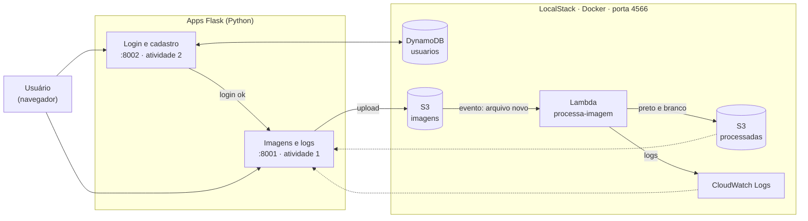

# Atividade LocalStack

**Login, upload e processamento automático de imagens com serviços da AWS, rodando 100% local.**


---

## O projeto

As três atividades formam **um único sistema**:

1. o usuário **cria a conta e faz login**
2. **envia uma imagem**
3. a imagem é **processada automaticamente**: vira preto e branco

Tudo roda no **LocalStack**, um container Docker que simula a AWS. Não precisa de conta nem tem custo, e o código é o mesmo da AWS real.

---

## Serviços AWS

| Serviço | Papel no sistema | Atividade |
|---|---|---|
| **DynamoDB** | Guarda os usuários | 2 |
| **S3** | Guarda as imagens: original e processada | 1 |
| **Lambda** | Processa a imagem quando ela chega no S3 | 3 |
| **CloudWatch Logs** | Registra cada execução da Lambda | 3 |

---

## Arquitetura



---

## Passo a passo

| # | Ação | Serviço |
|---|---|---|
| 1 | O usuário **cria a conta** | DynamoDB grava o usuário |
| 2 | O usuário **faz login** | DynamoDB confere a senha |
| 3 | O usuário **envia uma imagem** | S3 guarda no bucket `imagens` |
| 4 | O S3 **dispara a Lambda** sozinho | evento de upload |
| 5 | A Lambda **converte e salva** | S3 guarda no bucket `processadas` |
| 6 | O site mostra **original × processada** e os **logs** | S3 + CloudWatch |

> O app só faz login e upload. O resto acontece **por eventos**: é a ideia de **serverless**.

---

## Estrutura

```
atividade-local-stack/
├── docker-compose.yml   # LocalStack: DynamoDB, S3, Lambda e Logs
├── start.sh             # sobe tudo com um comando
├── index.html           # front-end único (Bootstrap)
├── atv1-amazons3/       # imagens: upload, lista, download e logs
├── atv2-dynamodb/       # contas: cadastro e login
└── atv3-lambda/         # função que processa a imagem + deploy
```

---

## Como rodar

**Pré-requisitos:** Docker Desktop aberto e Python 3.

```bash
./start.sh
```

| Página | Endereço |
|---|---|
| Login e cadastro | http://localhost:8002/login |
| Imagens | http://localhost:8001/imagens |
| Logs da Lambda | http://localhost:8001/logs |

**Para parar:** `Ctrl+C` e depois `docker compose down`
